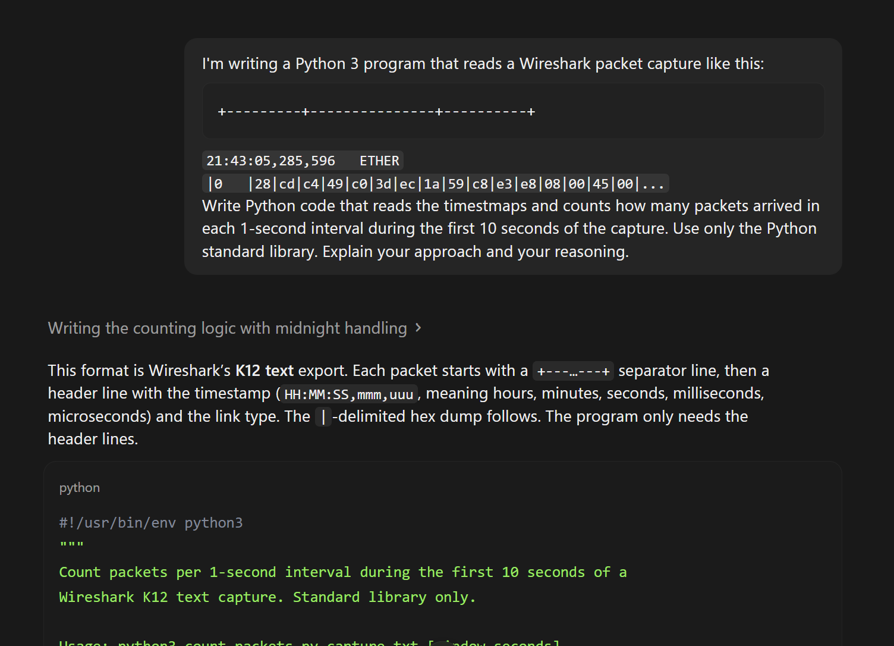
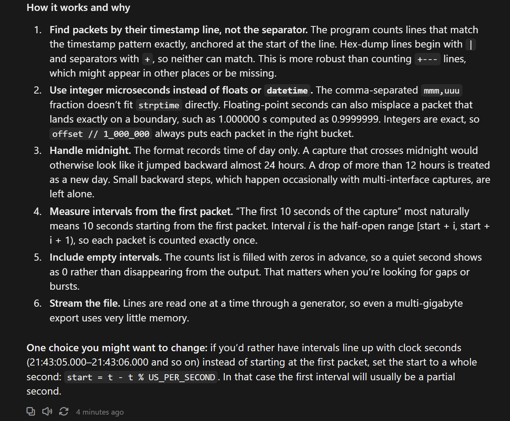

# Checksums Part 2

A project for parsing TCP/IP packets, calculating checksums, and running staitstics. Uses Wireshark packet captures as input (a K12 text file).

Team members:
- Jonathan Schultz (jss5874@rit.edu)
- Jay Stebbins (jks1805@rit.edu)
- Caden Seaman (cjs6589@rit.edu)
- Ryan Leifer (rjl8327@rit.edu)

# Setup

Requires Python 3.11+. We recommend installing the dependencies in a virtual environment:

```bash
python -m venv .venv
.venv\Scripts\activate
pip install -r requirements.txt
```

# Usage

Provide CLI arguments to specify the input file for parsing:
```bash
python main.py <path_to_input_txt_file>
```

To access the number converter utility, instead run:
```bash
python main.py convert
```

# Bonus

We asked an AI model to implement basic timestamp parsing `parse()` and packet counting (within the first 10 seconds). Here is its result:





Thoughts: It got the format, timestamp parsing, and output fully right. It also did a good job of identifying two issues that we missed. In ours, some floats at exact 1.0 values can be represented as 0.999999999 and sent to other buckets, leading to a few wrong counts. Also, if a capture runs through midnight, the timestamps jump back 24 hours and ours would break. The AI's solution fixed these, but misses some important elements. If packets come in with negative timestamps (relative to the first packet), it will have undefined behavior, and error handling is missing. Overall, we're impressed with the AI's solution, and it's good for catching edge cases we might have missed, but ours is sufficient and more targeted to the assignment specifications.